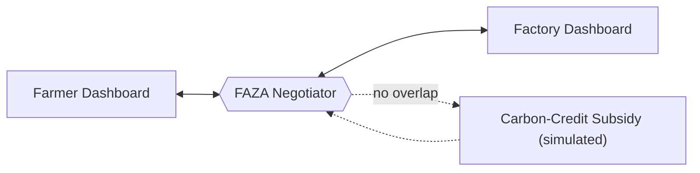

# FAZA (فضا)
### The AI Stubble-to-Fuel Negotiator

*Hackathon theme: AI with Purpose, Building Better Societies*

> Farmers burn what factories need. FAZA brokers the deal that stops the smoke.

---

## The Problem

Every season, Punjab's farmers have to clear their fields fast. The machinery to do it properly is out of reach for most of them, so they burn the stubble. The smoke settles over cities as seasonal smog.

Meanwhile, industrial biomass factories want exactly that stubble as cheap fuel. But the farms are scattered, transport is expensive, and no factory will pay a high price to collect it.

|  | Farmer | Factory |
|---|---|---|
| **Has** | Stubble, and no time | Demand for fuel |
| **Can't afford** | Clearing machinery | High transport costs |
| **Default outcome** | Burns the field | Buys elsewhere |

Both sides would gain from a deal. Neither can reach one alone. The air pays for the gap.

---

## The Solution

FAZA is an AI mediator that sits between farmer and factory. It learns what each side needs, finds the overlap, and proposes a deal both can accept. When no deal exists, it closes the gap with a carbon-credit subsidy.

---

## How It Works

FAZA runs every negotiation through four steps. Each one is revealed to the user as a **mystery card**.

| # | Card | What FAZA does |
|---|---|---|
| 1 | **Understand Demands** | Collects what each side needs and what it can't give up |
| 2 | **Find Common Ground** | Compares both positions and locates the overlap |
| 3 | **Suggest Balanced Solution** | Proposes a deal that works for both |
| 4 | **Handle No-Compromise** | If no overlap exists, applies a simulated carbon-credit subsidy to bridge the gap |

---

## System Architecture

**Dual dashboard**

| Farmers | Factories |
|---|---|
| Submit stubble availability and constraints | Submit fuel demand and cost limits |
| View the mystery-card negotiation as it unfolds | View the same negotiation from their side |
| Accept or reject the proposed deal | Accept or reject the proposed deal |

**Negotiator core.** Receives both inputs, runs the four-step flow, and returns one proposal to both dashboards.

**Subsidy module.** Triggered only on deadlock. Calculates the shortfall and covers it with a simulated carbon credit.

---

## MVP Scope

**Included**
- Farmer and Factory dashboards
- Full four-card negotiation flow
- Simulated carbon-credit subsidy on deadlock

**Not in the MVP**
- Real payment settlement
- Live carbon-credit market integration
- Logistics and fleet scheduling

---

## What Success Looks Like

- **Farmers** earn from stubble instead of burning it.
- **Factories** get fuel at a price that works.
- **Everyone else** gets cleaner air.

---

FAZA (فضا) · MVP Document
